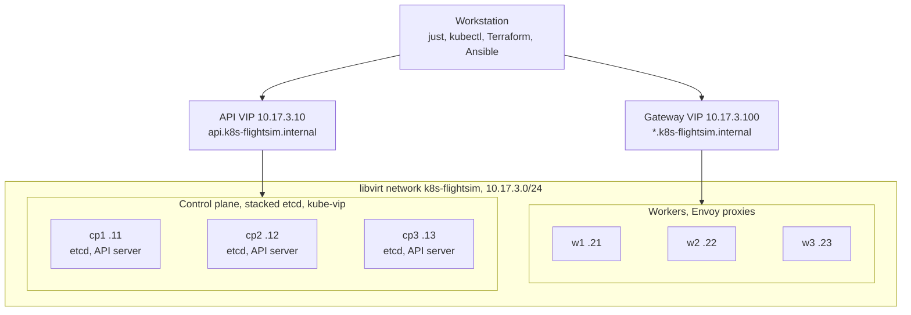
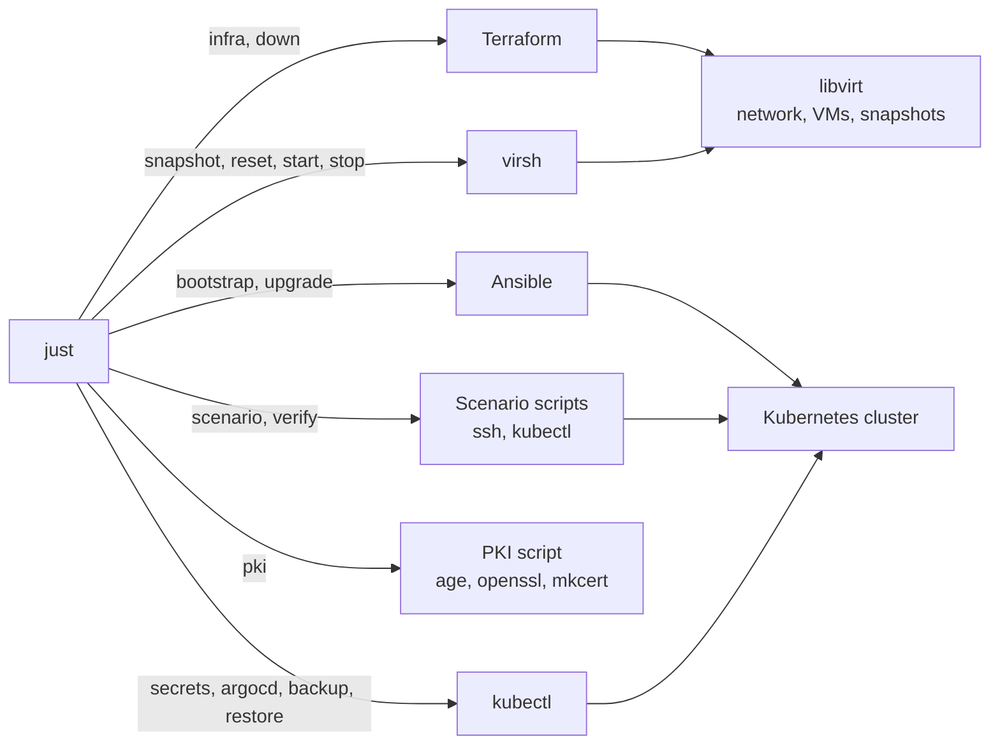
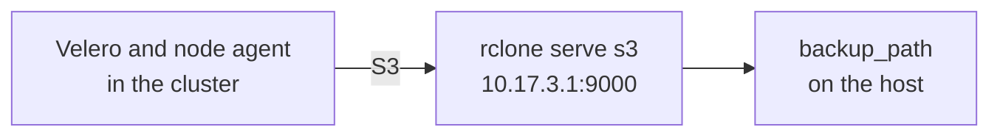
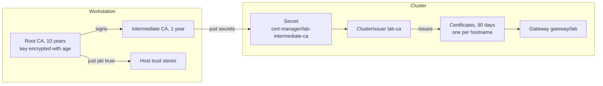
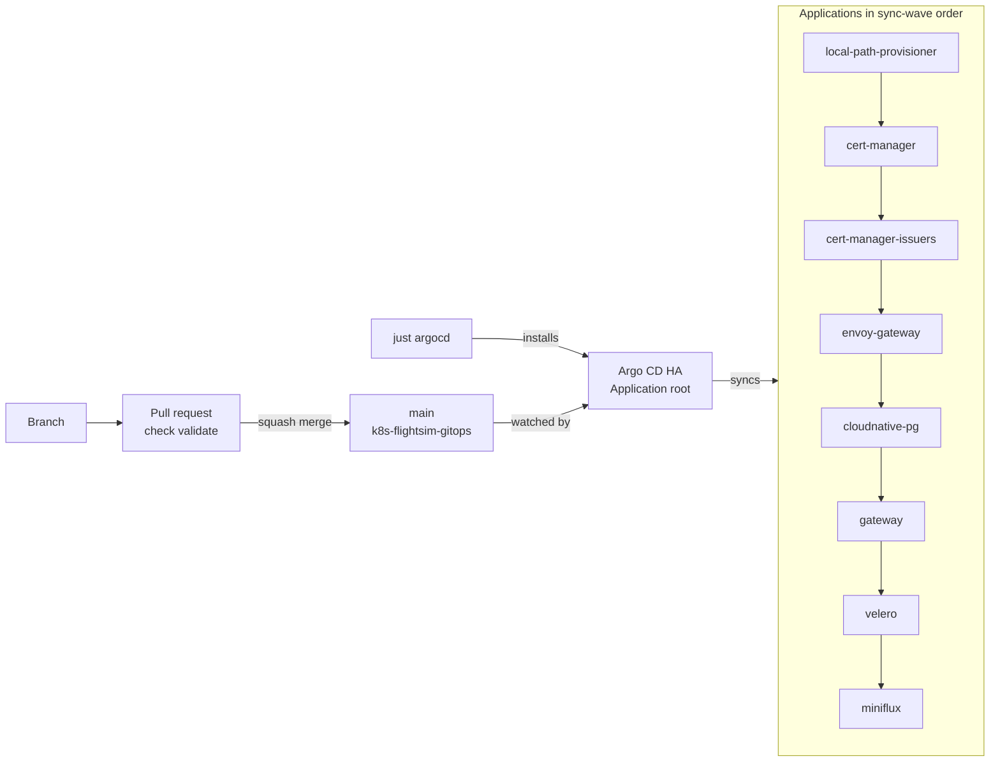
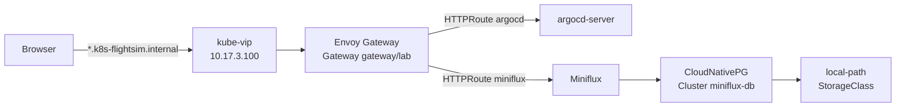

# k8s-flightsim

[](https://github.com/s3n-ops/k8s-flightsim/actions/workflows/quality.yml)

A local Kubernetes lab for practising operations, troubleshooting and
disaster recovery. It works like a flight simulator. Break something on
purpose, fix it, verify it, roll back to a snapshot and repeat.

[Terraform](https://developer.hashicorp.com/terraform) creates six VMs on
libvirt. [Ansible](https://docs.ansible.com) installs a kubeadm cluster
with three control plane nodes and three workers. Argo CD deploys the
platform and a sample application from a separate GitOps repository,
[k8s-flightsim-gitops](https://github.com/s3n-ops/k8s-flightsim-gitops).
[just](https://github.com/casey/just) manages the lab: build, snapshots,
scenarios and backups. The cluster itself is used like any other, through
`kubectl` and the web UIs.

The cluster is stock Kubernetes: kubeadm on Ubuntu, with containerd and
Calico.

## Topology



[kube-vip](https://kube-vip.io) runs on the control plane nodes and
announces both virtual IPs by
[ARP](https://en.wikipedia.org/wiki/Address_Resolution_Protocol). The API
VIP leads to the API servers, the gateway VIP to the Envoy proxies on the
workers.

| Role | Count | vCPU | RAM | Disk |
|---|---|---|---|---|
| Control plane | 3 | 2 | 3 GiB | 20 GiB |
| Worker | 3 | 2 | 4 GiB | 30 GiB |
| **Total** | 6 | 12 | 21 GiB | 150 GiB (thin provisioned) |

Sizes and addresses are in `terraform/variables.tf`. `just usage` shows
how much of the pool is in use.

The lab network serves DNS for `k8s-flightsim.internal`. `api` and the
node names have their own records. Every other name points to the gateway
VIP. libvirt registers the domain with systemd-resolved on the host, so
the host resolves lab names without any configuration of its own.

| Component | Pinned in |
|---|---|
| Ubuntu LTS, minimal cloud image | `terraform/variables.tf` |
| Kubernetes, including the upgrade target | `ansible/group_vars/all.yml` |
| containerd | Ubuntu package |
| Calico, kube-vip | `ansible/group_vars/all.yml` |
| Terraform provider dmacvicar/libvirt | `terraform/versions.tf` |
| Everything Argo CD deploys | the GitOps repository |

Versions are pinned only in these files, never in this README.

## Requirements

- Linux with KVM and libvirt 10.1 or later (`qemu:///system`), user in the
  group `libvirt`
- systemd-resolved on the host, for the lab DNS
- [Terraform](https://developer.hashicorp.com/terraform) 1.9 or later
  ([OpenTofu](https://opentofu.org) works as well)
- [Ansible](https://docs.ansible.com) (`ansible-core`) with the collections
  in `ansible/requirements.yml`
- [Nushell](https://www.nushell.sh) (scripts and `justfile`),
  [just](https://github.com/casey/just), `kubectl`
- [age](https://age-encryption.org) and `openssl`, for the lab PKI
- [rclone](https://rclone.org), for backups
- An SSH key at `~/.ssh/id_ed25519.pub`
- Optional: [mkcert](https://github.com/FiloSottile/mkcert), to trust the
  lab CA on the host
- Optional: [nu-lint](https://codeberg.org/wvhulle/nu-lint) and
  [TFLint](https://github.com/terraform-linters/tflint), used by
  `just check` when installed

CI runs with the tool versions pinned in
`.github/workflows/quality.yml`. Terraform creates everything through the
libvirt API, so building the lab needs no root permissions. Only
`just pki trust` and `just pki untrust` run `sudo`, to change the system
trust store.

## Quick start

Clone both repositories into the same parent directory:

```bash
git clone https://github.com/s3n-ops/k8s-flightsim.git
git clone https://github.com/s3n-ops/k8s-flightsim-gitops.git
cd k8s-flightsim
```

Create the host settings, then set `pool_path` in
`~/.config/k8s-flightsim/host.tfvars` and `backup_path` in
`~/.config/k8s-flightsim/backup.toml`:

```bash
just init
ansible-galaxy collection install -r ansible/requirements.yml
```

Build the lab:

```bash
just pki init           # lab root and intermediate CA
just up                 # VMs, Kubernetes, snapshot "base"
just pki trust          # trust the lab root CA on this host (optional)
just secrets            # generate credentials, create the Secrets
just argocd             # Argo CD and the app of apps
just snapshot platform  # snapshot once all Applications are healthy
```

Point `kubectl` at the lab. `just kubeconfig` prints the path of the
kubeconfig.

```bash
# Bash
export KUBECONFIG="$(just kubeconfig)"
```

```nu
# Nushell
$env.KUBECONFIG = (just kubeconfig)
```

```bash
# direnv: .envrc in the parent directory of both repositories
export KUBECONFIG="$HOME/.local/share/k8s-flightsim/kubeconfig"
```

```bash
kubectl get nodes
```

## Usage

`just` manages the lab. Each recipe hands its work to one tool:



`just up` runs `infra`, `bootstrap` and `snapshot base` in a row.
`just rebuild` runs `down` and `up`.

```bash
just status             # VMs, network, nodes and system pods
just stop               # shut down VMs, backup target and network
just start              # start them again, wait for the API
just ssh cp1            # SSH into a node

just scenarios          # list scenarios
just scenario 01        # break the cluster, read the task
just hint 01            # hint
just verify 01          # solved?
just solution 01        # runbook with the solution
just reset              # back to "base"

just snapshot pre-x     # your own snapshot
just reset pre-x

just rebuild            # delete everything and build it again
just down               # delete everything, snapshots included
```

`just` without arguments lists all recipes.

## Scenarios

| ID | Type | Level | Topic | Runbook |
|---|---|---|---|---|
| [01-kubelet-down](scenarios/01-kubelet-down/README.md) | Incident | easy | Worker reports `NotReady` | [node-notready-kubelet](docs/runbooks/node-notready-kubelet.md) |
| [02-apiserver-manifest](scenarios/02-apiserver-manifest/README.md) | Incident | medium | API server on cp1 does not start | [apiserver-static-pod](docs/runbooks/apiserver-static-pod.md) |
| [03-coredns-config](scenarios/03-coredns-config/README.md) | Incident | medium | Services cannot be reached by name | [coredns-misconfig](docs/runbooks/coredns-misconfig.md) |
| [04-etcd-quorum-loss](scenarios/04-etcd-quorum-loss/README.md) | Disaster | hard | Two control plane nodes destroyed | [etcd-quorum-loss](docs/runbooks/etcd-quorum-loss.md) |
| [05-kubeadm-upgrade](scenarios/05-kubeadm-upgrade/README.md) | Drill | medium | Cluster upgrade with kubeadm | [kubeadm-upgrade](docs/runbooks/kubeadm-upgrade.md) |
| [06-etcd-snapshot](scenarios/06-etcd-snapshot/README.md) | Drill | easy | Take an etcd snapshot | [etcd-snapshot](docs/runbooks/etcd-snapshot.md) |

Each runbook follows the same structure: Symptom, Diagnosis, Cause, Fix,
Verify, Prevention. [`scenarios/README.md`](scenarios/README.md) describes
the types, the layout of a scenario and how to add one.

## Snapshots

A snapshot saves the disks of all six VMs at one point in time. A scenario
starts from a known state, and `just reset` undoes it.

| Snapshot | Contains | Created by |
|---|---|---|
| `base` | Bare cluster: Kubernetes, kube-vip, Calico | `just up` |
| `platform` | `base` plus Argo CD, cert-manager, Envoy Gateway, Velero, local-path, CloudNativePG, Miniflux | `just snapshot platform` after `just argocd` |

`just snapshot <name>` works in five steps:

1. It stops if a snapshot with that name exists on any node. Delete it
   first with `just snapshot-delete <name>`.
2. It runs `fstrim` on every node, so deleted blocks are released and do
   not end up in the snapshot.
3. It shuts down the workers, then the control plane, and waits until all
   are off. After three minutes it forces the power off. Then it stops the
   lab network.
4. It takes an internal qcow2 snapshot of each VM
   (`virsh snapshot-create-as --atomic`). The VMs are off, so the snapshot
   holds disks only, no memory, and all three etcd members share one
   consistent point in time.
5. It starts the network, the control plane, then the workers, and waits
   up to five minutes for the API server.

`just reset <name>` powers all VMs off hard, reverts them and starts them
again. The lab returns to exactly the state the snapshot saved, on every
node and in etcd. Argo CD then syncs the GitOps repository again, so
changes merged since the snapshot come back on their own.

```bash
just snapshots                  # list
just snapshot-delete platform   # replace an outdated snapshot
just snapshot platform
just reset platform
```

Snapshots live inside the qcow2 files of the VMs. `just down` deletes them
together with the VMs.

> [!NOTE]
> libvirt cannot undefine a VM that has snapshots, and the Terraform
> provider updates a VM by undefining and redefining it. A change to the
> VM definition (CPU, memory, disk options) therefore fails while
> snapshots exist. Delete them first or rebuild the lab:
>
> ```bash
> just snapshots                  # which snapshots exist
> just snapshot-delete platform   # delete each of them
> just snapshot-delete base
> just infra                      # apply the new VM definition
> ```

## Backups

Snapshots roll back the whole lab. Backups protect what runs in the
cluster. [Velero](https://velero.io) saves the Kubernetes objects of all
namespaces and copies the contents of volumes with Kopia. The backups go to
a directory on the host, outside the cluster and outside the VM pool, so
they survive the loss of both.



Set `backup_path` in `~/.config/k8s-flightsim/backup.toml`, then run
`just secrets` once more. It creates only the values that do not exist
yet, here the S3 keys and the Kopia repository password. Existing values
stay as they are and are applied to the cluster again unchanged.

The S3 endpoint is rclone on the host. Velero needs it for every backup,
restore and repository maintenance. It runs only while the lab runs.
`just start`, `just up` and every snapshot or reset start it as a
transient systemd user unit, `k8s-flightsim-s3`. `just stop` and
`just down` stop it again. No unit file is written, and nothing is left
after a reboot. `just status` shows its state.

Velero backs up all namespaces every 24 hours and keeps each backup for 7
days. The interval counts from the last backup, so a backup that was due
while the lab was off runs soon after the next start. Manual backups are
kept for 30 days.

```bash
just backup                         # back up all namespaces now, asks first
just backup before-upgrade          # the same, with a name
just backups                        # list backups and the space they use
just restore before-upgrade         # restore a backup, asks first
just backup-delete before-upgrade   # delete a backup and its data, asks first
just backup-prune                   # keep only the newest completed backup, asks first
just backup-prune 3                 # keep the newest three
```

Kopia stores each block only once. Every backup after the first adds only
changed blocks, and backups share their space, so the size of a single
backup cannot be given. `just backups` shows the space of the whole
backup directory. Space of deleted backups is released by Kopia's
repository maintenance, which can take a day or more.

A restore recreates missing resources and leaves existing ones as they
are. To bring back a deleted namespace in its old state, delete it
completely first.

rclone listens on the lab bridge only and requires the S3 credentials from
`just secrets`. Most host firewalls let the libvirt network reach the host
already. If Velero reports its storage as unavailable, check from a node
(a 403 means the endpoint is reachable) and open TCP port 9000 if needed:

```bash
just ssh w1 curl -s -o /dev/null -w '%{http_code}' http://10.17.3.1:9000/

# ufw
sudo ufw allow in on virbr-fsim to 10.17.3.1 port 9000 proto tcp
# firewalld (libvirt puts its bridges in the zone "libvirt")
sudo firewall-cmd --permanent --zone=libvirt --add-port=9000/tcp
sudo firewall-cmd --reload
```

> [!NOTE]
> Velero skips the pods and volumes of the CloudNativePG cluster. A file
> copy of a running PostgreSQL is not consistent. After a restore,
> CloudNativePG creates an empty database.

The Kopia repository is encrypted with `velero-repo-password`. A rebuilt
cluster can restore the old backups only with the same password, which
`just secrets` takes from `~/.local/share/k8s-flightsim/secrets/`.

## Certificates

The lab runs its own two-tier PKI, like an internal company CA:



| CA | Lifetime | Key | Name constraints |
|---|---|---|---|
| Root | 10 years[^root] | on the host only, encrypted with age | `k8s-flightsim.internal`, no IP addresses |
| Intermediate | 1 year | on the host and in the cluster (cert-manager) | same |
| Server certificates | 90 days, renewed by cert-manager | in the cluster | one per hostname, no wildcard |

[^root]: Ten years is the default root lifetime of common CA tools such as
    mkcert and smallstep step-ca. A production PKI differs mainly in how
    the root key is kept: offline in a hardware security module, used only
    in a documented key ceremony, with revocation published as CRL or OCSP.
    The lab keeps the key encrypted on the workstation and publishes no
    revocation.

The root key never reaches the cluster. If the cluster is compromised,
only the intermediate CA is lost. Rotate it, and the host keeps trusting
the root. The name constraints limit both CAs to names under
`k8s-flightsim.internal`. A certificate for any other domain or for an IP
address fails validation, even though the root is in the host trust store.

`just pki init` encrypts the root key with
[age](https://age-encryption.org) to the recipients in
`~/.config/k8s-flightsim/pki.toml` (age or SSH public keys, inline or as a
recipients file). Only the holder of a matching identity can sign a new
intermediate. The identity can live in a file, in a password manager or on
a YubiKey (`age-plugin-yubikey`). Without recipients, `just pki init` asks
for a passphrase instead. The decrypted root key stays in memory and is
never written to disk.

```bash
just pki init                  # root and intermediate CA
just pki                       # status: expiry, constraints, chain check
just pki rotate-intermediate   # yearly, decrypts the root key with your identity
just pki trust                 # trust the root CA on this host
just pki untrust               # remove it again
```

`just pki trust` and `just pki untrust` hand the work to
[mkcert](https://github.com/FiloSottile/mkcert). Its README lists the
[trust stores it updates](https://github.com/FiloSottile/mkcert#supported-root-stores).
mkcert only gets a copy of the root certificate, never a key, so it cannot
issue certificates of its own.

> [!IMPORTANT]
> Keep the age identity or the passphrase safe. Without it, a new
> intermediate needs a new root, and every host has to trust the new root.

## GitOps

The desired state of the cluster lives in the
[k8s-flightsim-gitops](https://github.com/s3n-ops/k8s-flightsim-gitops)
repository. It holds only manifests. Argo CD runs in HA mode and applies
them as an app of apps, in sync waves that wait for each Application to
become healthy. `just argocd` installs Argo CD from the local checkout in
`../k8s-flightsim-gitops`.



Changes reach `main` only through pull requests that pass the `validate`
check and are squash merged. The
[README of the GitOps repository](https://github.com/s3n-ops/k8s-flightsim-gitops#readme)
describes the Applications, their projects and sources.

### Web UIs

| UI | URL | Login |
|---|---|---|
| Argo CD | <https://argocd.k8s-flightsim.internal> | `admin`, password from `just argocd-password` |
| Miniflux | <https://miniflux.k8s-flightsim.internal> | `admin`, password from `just miniflux-password` |

Both run behind Envoy Gateway with certificates from the lab CA. Once the
root CA is trusted, the browser shows no warning. There is no Kubernetes
Dashboard. `kubectl` and `just status` show the same information.



### Command line

```bash
kubectl -n argocd get applications          # SYNC and HEALTH per Application
kubectl -n argocd describe application miniflux
kubectl -n miniflux get clusters.postgresql.cnpg.io,pods
```

With the optional [Argo CD CLI](https://argo-cd.readthedocs.io/en/stable/cli_installation/):

```bash
argocd login argocd.k8s-flightsim.internal --grpc-web --username admin --password "$(just argocd-password)"
argocd app list
argocd app sync miniflux
```

## Files outside the repository

Nothing host-specific or secret lives in the working tree. The lab follows
the XDG base directories: settings in `~/.config`, credentials in
`~/.local/share`.

```
~/.config/k8s-flightsim/                 settings, safe for dotfiles
  host.tfvars                            pool_path, disk_cache
  pki.toml                               age recipients for the root key
  backup.toml                            backup_path, the directory served as S3

~/.local/share/k8s-flightsim/            credentials, mode 700, never in dotfiles
  kubeconfig                             cluster admin, mode 600
  secrets/                               generated credentials, mode 700
    miniflux-admin-password              mode 600
    velero-s3-access-key, -secret-key    S3 credentials of Velero and rclone
    velero-repo-password                 encrypts the Kopia volume backups
  pki/                                   mode 700
    root-ca.crt                          public, trusted on the host
    root-ca.key.age                      root key, encrypted with age
    intermediate-ca.crt, .key            signs server certificates in the cluster
```

| File | Created by | Overwritten |
|---|---|---|
| `conf/*.skel.*` | the repository | with every update, they only document the defaults |
| `~/.config/k8s-flightsim/host.tfvars`, `pki.toml`, `backup.toml` | `just init`, copied from `conf/` | never, compare them with the skeletons after an update |
| `~/.local/share/k8s-flightsim/kubeconfig` | `just up` (Ansible) | on every new cluster |
| `~/.local/share/k8s-flightsim/secrets/*` | `just secrets`, random on first use | never, a rebuilt cluster gets the same credentials |
| `~/.local/share/k8s-flightsim/pki/*` | `just pki init` | never, `just pki rotate-intermediate` archives the old intermediate |

`just infra` and `just down` refuse to run without `host.tfvars`. Without
the file, Terraform would fall back to the default `pool_path` from
`terraform/variables.tf`, plan a new pool there and replace every VM.
`FLIGHTSIM_CONFIG_DIR` and `FLIGHTSIM_DATA_DIR` override both directories.
Otherwise `XDG_CONFIG_HOME` and `XDG_DATA_HOME` apply.

`~/.local/share/k8s-flightsim/` holds the only copy of the encrypted root
CA key and of the Kopia repository password. Include it in the backup of
the host. Without the password, the Velero backups cannot be restored.

### Local settings

Local changes belong in `~/.config/k8s-flightsim/`, never in the working
tree, so `git pull` never conflicts with them.

| File | Controls |
|---|---|
| `host.tfvars` | every variable in `terraform/variables.tf`: pool path, disk cache, node sizes and count, OS image |
| `pki.toml` | age recipients and identity for the root CA key |
| `backup.toml` | the directory served as S3 for backups |

Ansible settings (Kubernetes, Calico and kube-vip versions, pod and service
CIDRs) have no local override. They are the same on every host, and the
scenarios depend on them, for example the upgrade drill on the Kubernetes
version.

> [!WARNING]
> `network_cidr`, `gateway_ip` and `dns_domain` can be changed in
> `host.tfvars`, but the GitOps repository contains the gateway address,
> the backup endpoint and the domain as fixed values. Changing them breaks
> HTTPS access and backups unless the GitOps repository changes as well.

## Slow disks

etcd calls `fsync` on every write. On a slow pool disk (consumer SATA SSD,
disk encryption) leader leases expire under load, and control plane pods
restart. `disk_cache = "unsafe"` in `host.tfvars` makes QEMU acknowledge
guest flushes at once.

> [!WARNING]
> This is a deliberate trade-off for a lab. A host crash or a power loss
> can corrupt the VM disks and their snapshots, and `just rebuild` is the
> recovery. Never use it in production. Without the setting, the lab keeps
> the safe libvirt default.

## Layout

```
conf/          Skeletons for the host settings
terraform/     libvirt: network, DNS, volumes, VMs, cloud-init, Ansible inventory
ansible/       kubeadm cluster with HA control plane, upgrade reference solution
scripts/       Nushell: snapshots, scenario runner, SSH, PKI, Secrets, checks
scenarios/     Break and verify
docs/runbooks/ Problem and solution
examples/      Seed data, e.g. Miniflux feeds (OPML)
```

## Development

```bash
just check   # Terraform fmt, validate and TFLint, ansible-lint, Nushell parse check, nu-lint
```

The same recipe runs in CI on every pull request. `main` changes only
through squash-merged pull requests, see
[`GITHUB_RELEASE_POLICY.md`](GITHUB_RELEASE_POLICY.md).

## Design

### Upstream components

The cluster is built from common upstream projects instead of a
Kubernetes distribution: kubeadm, containerd, Calico for the pod network
and Envoy Gateway for the Gateway API. What is practised here applies to
most self-managed clusters.

### Snapshots with the VMs off

A snapshot of running VMs would need memory images and would capture the
three etcd members at slightly different moments. With the cluster shut
down, all nodes share one consistent state.

### Backup target outside the cluster

A backup must not share a failure domain with what it protects. If the
S3 endpoint ran inside the cluster, losing the cluster would take the
backups with it, and a full restore could not be practised. The endpoint
therefore runs on the host and stores its data outside the VM pool. In
production the same role falls to an object store in another cluster,
region or provider.

### No secrets in git

The repositories hold no secrets, not even encrypted ones. `just secrets`
generates credentials on the host and creates them in the cluster. A
rebuilt cluster gets the same credentials.

### A lab domain with its own CA

[`.internal`](https://en.wikipedia.org/wiki/.internal) is reserved for
private networks and is not delegated in the public DNS. One certificate
per hostname keeps the blast radius of a leaked key small. The name
constraints make the root harmless outside the lab. A local lab would not
need either measure. The lab applies them anyway, because it is meant for
practising safe operations.

## AI Disclosure

Development was assisted by AI tools (Claude, OpenCode with OpenRouter, Junie).

## License

MIT License. See [LICENSE](LICENSE) for details.
